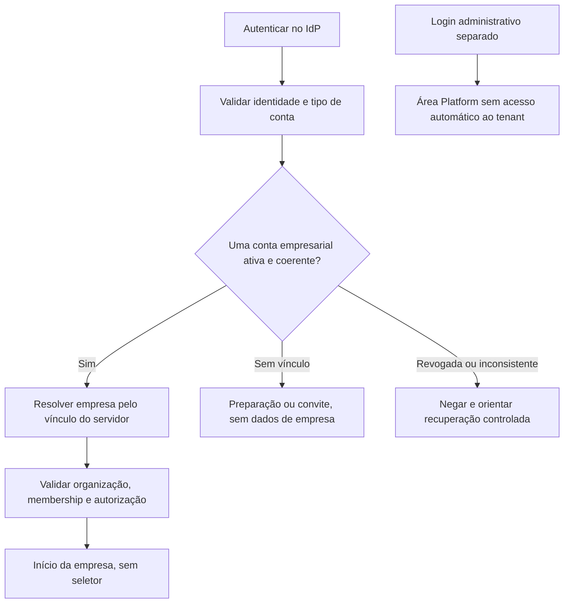

# Revisão — conta empresarial única por empresa

## Autoridade e status

**Diretriz de produto aprovada pelo gestor. Desenho técnico proposto, sem implementação autorizada. Consolidação final aprova também a restrição permanente de uma EnterpriseUserAccount por identidade OIDC durante todo seu ciclo de vida, inclusive após revogação; implementação física não aprovada.**

Esta revisão substitui a hipótese anterior de uma mesma conta operar várias organizações com seletor. Não altera ADRs aceitos 0001–0006, contratos técnicos implementados ou Foundation. ADRs 0007–0012 continuam Propostos. [Planejamento](SPRINT_1_PLANEJAMENTO.md), [C01–C10](SPRINT_1_CONTRATOS_FLUXOS.md), [RF/UAT](SPRINT_1_RASTREABILIDADE_UX.md) e [protótipos](../ux/sprint-1/README.md) passam a refletir a nova diretriz. A revisão é documental, sem código, migração, teste executável, commit ou push.

## M01 — Significados e invariantes

| Conceito | Significado recomendado; candidato técnico, não schema aprovado |
|---|---|
| Conta empresarial / ambiente da empresa | Uma Organization isolada representa uma empresa. Não criar tabela BusinessAccount redundante somente para renomear Organization |
| Identidade autenticada | Identidade técnica do IdP, reconhecida por issuer/subject e ID interno; não é empresa, e-mail ou pessoa civil |
| Conta de usuário empresarial | EnterpriseUserAccount candidata, vinculada a uma Organization imutável e uma identidade técnica; vários usuários podem trabalhar na mesma empresa |
| Membership | Papel/estado da conta de usuário no ambiente único; não dá suporte a múltiplas empresas no MVP |
| E-mail / nome | Atributos de contato/exibição; não identificador de empresa, prova de pessoa civil ou autorização para unir contas |
| PlatformOperator | Identidade/conta administrativa com esquema separado; não recebe conta empresarial nem membership automático |

Conta empresarial única não significa um único usuário por empresa. A expressão não obriga duplicar entidades: Organization continua sendo tenant e ambiente da empresa. EnterpriseUserAccount é a proposta para tornar vínculo e ciclo do usuário explícitos sem incorporar essas regras à Foundation.

Invariantes propostos: uma conta de usuário empresarial pertence a uma organização; uma identidade técnica tem no máximo uma EnterpriseUserAccount durante todo seu ciclo de vida, inclusive após revogação; Membership não pode apontar para organização diferente da conta; o vínculo não muda por login, recuperação, convite, rota, header ou payload. Identidade ainda sem conta pode existir em estado de preparação, mas não entra em dados empresariais. Resolver resultado zero, um ou inconsistente; nunca escolher o primeiro vínculo nem oferecer seletor para resolver inconsistência.

## M02 — Alternativas de identidade e recomendação

| Alternativa | Vantagens | Riscos / conclusão |
|---|---|---|
| Identidade técnica única com conta de usuário vinculada a uma empresa | Menor complexidade para login/contexto direto; vínculo verificável por constraint | Mesma credencial não atende segunda empresa; regra permanente de produto aprovada; mecanismo técnico sujeito a ADR |
| Identidade global com várias contas empresariais, resolvidas por subdomínio/convite | Pode permitir mesma pessoa/credencial em várias empresas sem menu | Incompatível com a regra de produto atual, não opção ativa para implementar; qualquer mudança exigiria nova decisão explícita de produto |
| Realm/IdP separado por empresa | Forte separação de credenciais por ambiente | Operação, recuperação e federação mais complexas; não necessário como padrão inicial |
| E-mail como chave que une organizações/usuários | Aparente conveniência | Acesso cruzado/acoplamento de identidade; não recomendado |

Regra de produto aprovada: preservar identidade técnica OIDC por issuer/subject e no máximo uma conta de usuário empresarial durante todo seu ciclo de vida. Recomenda-se selecionar provedor padrão por critérios, sem fornecedor escolhido. Não construir autenticação própria nem presumir que um provedor permita vários cadastros com o mesmo e-mail. Política de unicidade de credencial/e-mail no IdP e prova de titularidade continuam decisões pendentes.

### Mesma pessoa contratando outra empresa

Empresa B é novo ambiente, assinatura futura independente, contas de usuário e configurações próprios. A conta empresarial de usuário de A não recebe Membership B e não é convertida. Exige novo login com identidade técnica distinta, novo convite e nova conta, inclusive para funcionário desligado de A e ingressando em B; provedor/política devem suportar o processo aprovado; se isso não for possível com o provedor/política escolhidos, encaminhar para estudo fora do MVP, sem vincular automaticamente pelo e-mail ou criar bypass. Mesmo contato pode ser repetido como atributo somente se política aprovada permitir; não promete reutilização da mesma credencial.

Login com conta já vinculada a A e convite de B não migra/duplica vínculo: resposta ao destinatário autenticado informa impossibilidade de usar essa conta, sem revelar dados de B antes da prova. Ao emissor, erro mínimo não revela a empresa de origem. Conta revogada em A também não se torna disponível para B; desvinculação, transferência e gestão consolidada são futuras.

## M03 — Entrada e resolução segura

Cada requisição revalida conta, vínculo, estado da organização, membership/política e recurso. Cookie/claims não bastam como fonte eterna; não aceitar OrganizationId de cliente como autoridade. Rotas com orgId podem permanecer como escopo explícito, sempre igual ao vínculo resolvido; orgId divergente resulta em 404 genérico. Ausência de seletor não dispensa RLS, filtros, índices, auditoria ou testes A/B. `/me/context` resolve apenas o vínculo da identidade corrente.

Abas da mesma sessão usam a mesma empresa. Troca de identidade/login em uma aba exige que as outras revalidem antes de renderizar resposta/restaurar/salvar; descartar respostas antigas. Nunca trocar empresa dentro da mesma conta ou reaproveitar rascunho de outra conta/empresa.

## M04 — Usuários, convites e recuperação

Baseline de segurança mantida: destinatário conhecido por identidade técnica+referência voluntária, sem diretório público; URL sem segredo e código separado; preview autenticado; confirmação explícita; expiração/versão/uso único; cancelamento/substituição e replay reautorizado. Simplificar a linguagem, não retirar a prova de identidade.

Destinatário sem vínculo empresarial pode preparar identificação após login no IdP. Aceitação vincula a conta à empresa do convite e cria conta/membership Member em transação atômica. Concorrência de convites A/B disputa unicidade da identidade: somente uma vinculação vence. A segunda não cria conta, membership ou acesso cruzado; estado recusado não consome o convite como se aceito. Usuário já ativo na mesma empresa retorna conflito apropriado; revogado não reativa. Account.OrganizationId é imutável.

Owner inicial: operador confere identidade sem vínculo e referência, cria Organization+EnterpriseUserAccount+Membership Owner+auditoria no mesmo commit. Se a identidade já estiver vinculada, tudo falha sem organização órfã. Não criar conta empresarial sem dono como atalho.

Recuperação de senha/MFA é do IdP e nunca cria outra empresa ou vínculo. Recuperar conta revogada não reativa permissão; conta bloqueada/vínculo ausente/inconsistente seguem atendimento controlado sem seletor. Perda de acesso empresarial não implica logout de todas as aplicações nem promessa de recuperação de dados não salvos.

## M05 — Contratação, produtos, licenças e parâmetros

Diretriz aprovada: cada empresa possui assinatura independente; produtos/módulos podem ser individuais ou pacotes; licenças/permissões/configurações pertencem àquela empresa. A mesma empresa poderá usar GIV, ERP Imobiliário, ERP Multissetorial e CRM conforme direitos contratados. Não criar nova empresa por aplicação nem compartilhar assinatura entre empresas por pessoa/e-mail.

Contrato mínimo futuro: OrganizationId em Subscription e SubscriptionItems/versionamento, ProductId/Module/Feature em entitlements, origem/vigência/limites, vínculo de provisionamento com a empresa e reconciliação. Pacote comercial expande direitos somente na empresa contratante. Fluxo futuro catálogo/plano→assinatura→entitlements→provisionamento confirmado→autorização no produto permanece; billing não é autorização. Sem tabelas, endpoints ou cobrança na Sprint 1.

Membership/RBAC permite uma ação administrativa; não é licença, assinatura, produto habilitado ou assento pago. Criar usuário não compra licença; Owner não recebe todos os módulos por papel. Modelo de assentos/consumo e alocação produto-usuário é decisão futura. Na Sprint 1, recurso de demonstração não representa licença comercial e não concede acesso a produtos reais.

Parametrização futura pertence à empresa e à aplicação responsável, com versão, prévia/validação/confirmação/auditoria. Template versionado por aplicação/atividade (CNAE quando aplicável) orienta, não impõe regra universal. Ajustar A não muda B; compartilhar template não compartilha configuração/dados. ERP/CRM/produtos mantêm bancos, regras operacionais e interfaces próprios. IA é assistência opcional futura.

## M06 — Persistência, RLS e RBAC propostos

Preservar PostgreSQL próprio do Core e banco por aplicação; isolamento dentro de produto depende de ADR. Proposta candidata: EnterpriseUserAccount com PK escalar, identity_id UNIQUE, organization_id NOT NULL/imútavel, estado/versão; Membership com account_id UNIQUE e FK composta `(organization_id, account_id)` para conta coerente. IdentityLink conserva UNIQUE issuer/subject. Não reduzir unicidade a registro ativo: revogação não libera outra empresa. Contas Platform são tipo/escopo separado, não conta empresarial reaproveitada.

RLS USING/WITH CHECK, contexto validado por transação, ausência de contexto negada, runtime sem ownership/superuser/BYPASSRLS/DDL/TRUNCATE, pooling sem estado residual e portas bootstrap/Platform restritas continuam necessários. Identidade sem empresa só acessa preparação/convite próprio. Revogação concorre com comando por locks/versão; autorizar antes de replay. Duplicidade/inconsistência nega e gera sinal, não escolhe tenant.

Owner/Admin/Member mantêm C08: Owner altera outro Admin/Member; Admin só revoga outro Member; Member lê permitido; sem autoelevação, mudança de OrganizationId, edição de Owner, transferência ou reativação. Platform cria ambiente e proprietário sem membership automático. Nenhuma ampliação da Foundation ou nova migration está autorizada.

## M07 — Contratos retirados e cobertura substituta

| Hipótese proposta anterior | Situação nesta revisão | Substituto proposto / motivo |
|---|---|---|
| GET /me/organizations | Retirada do MVP proposto, nunca alegada como endpoint implementado | GET /me/context: resultado único/no vínculo/negado; sem lista de empresas |
| POST /me/organization-selections | Retirada; não gerar eventos de seleção | Login/resolução e acesso auditados conforme política; GET não seleciona |
| P02 Minhas organizações | Superada como experiência padrão | Início da empresa com contexto já resolvido |
| P03 Escolher/trocar organização | Superada | Navegação empresarial direta e contexto somente informativo |
| Ana com conta Owner em A/B | Fixture substituída, não alteração de usuário real | Ana_A em A; identidade distinta Ana_B em B ou Bruno_B para negativos |
| Abas independentes escolhendo A/B na mesma sessão | Fora do MVP | Mesma conta/empresa em todas as abas; troca de login exige revalidação |

RF-04/05 e UAT-07/12/14 são revisados, não preservados com semântica obsoleta. Testes A/B continuam: conta A nega B, payload/rota/arquivo/cache/busca/evento não atravessam tenant, pooling, convites simultâneos e recuperação não mudam o vínculo.

## M08 — Seis temas da revisão humana

O pedido atual identifica seis temas, sem transcrição adicional da revisão humana anterior. O tratamento abaixo cobre os temas disponíveis; não atribui aprovação a textos ou parâmetros não fornecidos.

| Tema | Tratamento nesta revisão | Limite / pendência |
|---|---|---|
| Simplificação de identificação | P04 "Preparar meu convite", campos técnicos em detalhes; copiar dados ainda mantém provas | Não criar parser/pacote único ou diretório global implicitamente |
| Entrega de convite | Explicar endereço+código, cópia controlada e destinatário autenticado | E-mail/WhatsApp/envio automático não aprovados; canal fica com emissor |
| Prazo de segurança | Mostrar validade do servidor, tempo restante e recuperação sem números como decisão | Hipóteses 24 h/idle/retomada de C07 continuam para revisão; não reduzir controle para simplificar |
| Resultado incerto | P10 consulta/replay da mesma chave e substituição explícita para segredo perdido | Não anunciar rollback nem nova criação sem prova |
| Aplicações futuras | P11 somente conceito; futura lista contratada por empresa sem botão comercial na Sprint 1 | Sem catálogo, licença, assinatura ou launch real |
| Demonstração técnica | P12 somente homologação/avaliação, fora do início empresarial normal | Não módulo de negócio nem tela operacional dos produtos |

## M09 — Matriz de impacto documental

| Documento / contrato / protótipo | Mudança | Justificativa |
|---|---|---|
| Plano Diretor e Consolidação | Registrar nova diretriz e retirar seleção padrão dos requisitos vigentes | Produto aprovado tem ambiente único por conta |
| ADR-0007 | Distinguir identidade técnica/conta empresarial; segunda empresa não une login automaticamente | Evitar usar e-mail/SSO como autorização |
| ADR-0008 | Unicidade de vínculo e entrada direta | Não modelar Membership múltiplo no MVP |
| ADR-0009 | Constraints/FKs, resolução única/RLS e concorrência A/B | UX simples exige defesa persistente |
| ADR-0010 | RBAC no vínculo único e Platform separado | Não criar administrador multiempresa |
| ADR-0011 | Auditoria de vínculo/resolução, sem seleção | Remover comando/evidência de troca que não existe mais |
| ADR-0012 | Portal direto, /me/context, preparação restrita | Mesmo caso de uso nos adapters web/API |
| C01–C10 | Reespecificar contexto/convites; preservar ETag, idempotência, CSRF e sessão | Sem perder segurança nem manter contratos contraditórios |
| RF-01–20/UAT-01–19 | Substituir fixtures e semântica de seleção; incluir unicidade/relogin | Evidência funcional corresponde ao produto |
| Fechamento UX-01–16 | Reavaliar achados de seleção/abas; preservar histórico explicitamente superado | Não declarar gate anterior aprovado |
| Backlog S1-00–11 | Contexto único, conta/constraint, convite e UI direta | Reestimar sem prazo confirmado |
| P02/P03 | Início e cabeçalho da empresa, sem seletor | Menor navegação e ausência de troca padrão |
| P04/P05/P06/P07 | Identificação e convite só vinculam empresa única; membros não equivalem a licenças | Evitar convite como passagem para outra empresa |
| P09/P11/P12 | Platform separado; aplicações futuras; demo restrita à homologação | Respeitar fronteiras e escopo |

## M10 — Riscos e decisões pendentes

- Identidade única→uma conta empresarial permanente e novo login/convite para outra empresa são regras de produto já aprovadas. Aprovar a entidade candidata EnterpriseUserAccount, constraints, registro histórico mínimo e mecanismos de retenção/expurgo que preservem a regra; nenhum schema é aprovado automaticamente.
- Verificar política do IdP para outra empresa pela mesma pessoa, e-mail e recuperação; se credencial distinta não for suportada, caso não é resolvido no MVP.
- Aprovar cadastro/bootstrap e convite a identidade conhecida; convite por contato ainda desconhecido é estudo futuro.
- Confirmar duração de sessão/convite, mecanismos de entrega e storage técnico, privacidade/retenção, grants RLS, dependências e MaxOffset. Nenhum valor é aprovado nesta revisão.
- Conta única reduz opções de navegação, não custo de segurança. Operação já concluída não é desfeita por revogação; dados já vistos não são apagados por UX.
- Assinaturas/licenças/templates e apps não podem ser antecipados para preencher painel. Produto continua operacionalmente independente do Core.

Fontes técnicas de referência: [OIDC: estabilidade dos identificadores](https://openid.net/specs/openid-connect-core-1_0.html#ClaimStability), [PostgreSQL RLS](https://www.postgresql.org/docs/current/ddl-rowsecurity.html). As alternativas e recomendações deste documento são decisões propostas da plataforma, não conclusões impostas por esses protocolos.

## M11 — Consolidação final de identidade

A restrição é permanente, não apenas no MVP ou enquanto Active. Não liberar identidade por revogação, arquivamento ou exclusão lógica; propor marca histórica mínima que impeça segunda conta mesmo após remoção física de outras informações, com privacidade/retenção a revisar. Recuperar senha/MFA não muda sujeito, empresa ou permissão. Funcionário A→B precisa de novo login/identidade e novo convite; mesmo e-mail é atributo somente se política do IdP permitir. Nenhum fornecedor ou parâmetro de sessão foi escolhido/aprovado.

GET /me/context propõe 200 state=NotLinked somente para identidade nunca vinculada; substitui explicitamente hipótese anterior 409 nessa consulta, ainda para aprovação. Revogação e inconsistência não viram NotLinked. [Cenários I01–I12 e decisões técnicas](IDENTIDADE_CENARIOS_E_DECISOES.md) detalham rastreabilidade, alternativas HTTP e limites da revogação nos produtos independentes. As regras de produto estão aprovadas; ADRs/contratos técnicos/Gate/implementação permanecem pendentes.
