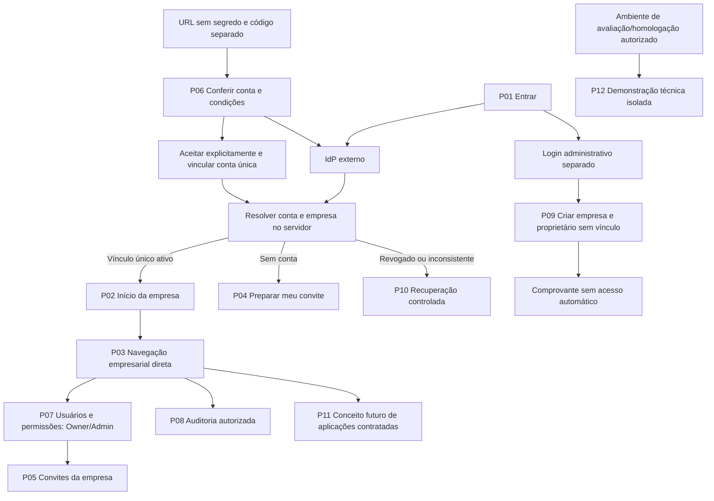
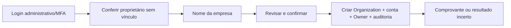
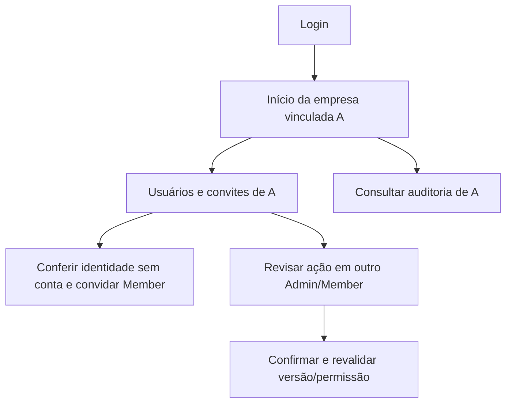
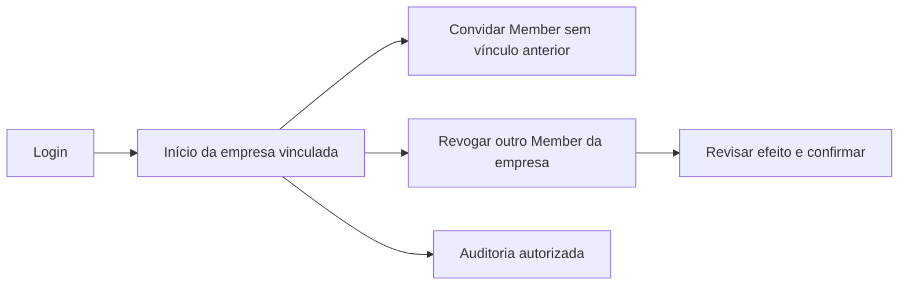
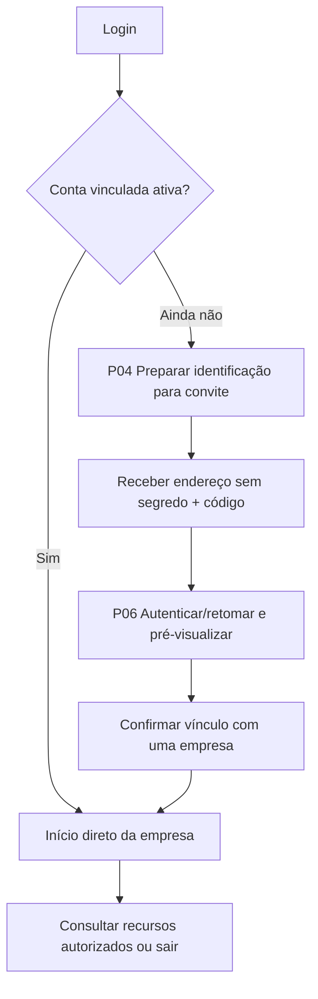

# Portal administrativo Core — prototipação UX exploratória

## Status e autorização

**Protótipos estáticos de baixa fidelidade, para avaliação humana. Não são aplicação implementada.**

Esta etapa autoriza somente documentação UX e protótipos não executáveis em Markdown/Mermaid. ADRs 0007–0012 permanecem Propostos; Gate UX, escolhas técnicas e Sprint 1 não estão aprovados. Nenhum botão, formulário, link de produto ou fluxo de autenticação representado aqui executa uma operação. Não há dados reais nos exemplos.

## Material para revisão

1. [Wireframes desktop e mobile P01–P12](WIREFRAMES.md): telas, confirmações, estados e recuperação.
2. [Alternativas, matriz de ações e roteiro de validação](AVALIACAO.md): permissões, acessibilidade, riscos e aceite da prototipação.
3. Este documento: fronteiras do produto, navegação e fluxos dos quatro perfis.

Referências consultadas no repositório:

- [Plano Diretor](../../architecture/decisions/PLANO_DIRETOR_BUSINESS_PLATFORM_CORE.md).
- [Consolidação estratégica ERP/CRM](../../architecture/CONSOLIDACAO_ESTRATEGICA.md).
- [Planejamento da Sprint 1](../../architecture/SPRINT_1_PLANEJAMENTO.md).
- [Contratos C01–C10](../../architecture/SPRINT_1_CONTRATOS_FLUXOS.md).
- [RF-01–RF-20 e UAT-01–UAT-19](../../architecture/SPRINT_1_RASTREABILIDADE_UX.md).
- [Fechamento UX-01–UX-16](../../architecture/SPRINT_1_FECHAMENTO_UX.md).
- ADRs propostos [0007](../../architecture/decisions/ADR-0007-oidc-identity-and-web-session.md), [0008](../../architecture/decisions/ADR-0008-organization-membership-and-context.md), [0009](../../architecture/decisions/ADR-0009-persistence-isolation-and-concurrency.md), [0010](../../architecture/decisions/ADR-0010-rbac-and-platform-tenant-segregation.md), [0011](../../architecture/decisions/ADR-0011-persistent-operational-audit.md), [0012](../../architecture/decisions/ADR-0012-executable-api-and-composition.md).

## Conta empresarial única — diretriz vigente

[Revisão arquitetural M01–M10](../../architecture/CONTA_EMPRESARIAL_UNICA.md): conta empresarial é o ambiente de uma empresa, representado por Organization; há vários usuários nesse ambiente, cada conta de usuário vinculada somente a essa empresa. Identidade técnica/e-mail/pessoa civil são distintos. Diretriz de produto aprovada; esquema, IdP, constraints e demais escolhas continuam Propostos.

Login empresarial entra diretamente na empresa validada. Sem lista/seletor/troca padrão e sem gestão multiempresa no MVP. Mesma pessoa em outra empresa exige conta/identidade independentes segundo política do IdP a aprovar, nunca vínculo automático. Assinatura, produtos/módulos individuais/pacotes, licenças e parâmetros pertencem à empresa; etapas comerciais/templates/IA são futuras.

## Visão confirmada e limites da experiência

O Core terá portal web administrativo central para identidade, organizações/contextos, memberships/convites/permissões, administração Platform e auditoria autorizada. Catálogo, contratação e habilitação são futuros. Este registro da visão confirmada não converte contratos técnicos propostos em decisões aceitas.

| Produto | Interface operacional própria | Papel do portal Core |
|---|---|---|
| GIV | Aplicativo mobile e web operacional | Futuro ponto de acesso e administração transversal; sem telas de veículo/viagem/frete |
| ERP Imobiliário | Web, mobile quando necessário | Sem cadastros de imóvel/locação/contrato imobiliário no Core |
| ERP Multissetorial | Módulos empresariais web | Sem absorver financeiro, fiscal ou operação empresarial |
| CRM Configurável | Aplicação autônoma, integração opcional ao ERP | Sem funil, lead ou negociação operacional no Core |

Portal central não significa credenciais, bancos ou interfaces operacionais únicos. Navegação de saída deve preservar a independência do produto e revalidar acesso no destino. Nenhum produto é aberto/habilitado por este protótipo. P12 é desenho de demonstração somente para avaliação/homologação, fora da navegação empresarial normal. Não é produto, interface operacional ou catálogo comercial.

## Convenções de leitura e linguagem

- `[Ação]` representa controle desenhado, sem comportamento implementado. `[sem ação]` significa texto explicativo, não botão funcional escondido.
- Dados como Ana, Bruno, Organização A e Organização B são fixtures fictícias.
- Nome de organização só aparece após validação de acesso; antes disso, estados de indisponibilidade são genéricos.
- Nome de exibição não é comprovação de identidade civil. IDs/referências nunca substituem autorização.
- Status Pending/Accepted/Expired/Cancelled/Replaced são apresentados como Pendente/Aceito/Expirado/Cancelado/Substituído. IDs técnicos ficam disponíveis em detalhes, sem dominar tarefas comuns.
- A navegação não mostra itens administrativos para Member. Essa decisão de apresentação não protege endpoint; a mesma política deve ser aplicada pelo backend futuro.

## Mapa de navegação revisado

Não há escolha de organização no callback, convite ou recuperação. GET consulta vínculo existente; aceite/owner bootstrap são comandos explícitos e atômicos. P11 é somente conceito futuro. P12 não compõe o início normal.

## Fluxos dos quatro perfis

### PlatformOperator

RF-03/UAT-17: proprietário já vinculado a A não é reutilizado para B; operação falha integralmente. Operador não ganha membership nem vê dados empresariais. Contratação/cobrança não são simuladas como aprovadas por criar o ambiente.

### TenantOwner

RF-04/09/13/15; UAT-04/06/08/16. Owner não escolhe B, não transfere conta e não concede licença comercial por promover papel. Convite inicial Member continua separado de promoção posterior.

### TenantAdmin

C08 mantém restrições sobre Admin/Owner/próprio usuário. Licenças e assinatura são futuras, não gestão de permissões genéricas por esta tela.

### TenantMember e destinatário em preparação

Se a conta já pertence a A, convite B não muda o vínculo. Rascunho/recuperação/login não criam acesso cruzado. Cadastro de identidade desconhecida por contato e entrega automatizada são futuros.

## Navegação por perfil

| Perfil | Itens normais | Exclusões |
|---|---|---|
| Member | Início da empresa, minha conta, aplicações somente como conceito futuro nesta revisão, sair | Membros administrativos, auditoria, escrita e qualquer seletor |
| Admin | Acima + usuários/convites e auditoria autorizada | Administração multiempresa, licença comercial, mudança de Admin/Owner |
| Owner | Acima + promoção/rebaixamento/revogação de outro Admin/Member | Alteração/transferência de Owner, mover empresa ou autoalterar papel |
| PlatformOperator | Criar empresa/proprietário, conta administrativa e sair | Seletor/entrada empresarial/impersonação e auditoria ampla |

Empresa/papel permanecem visíveis como informação, sem controle de troca. Todas as abas de uma sessão representam a mesma conta/empresa; troca explícita de identidade por logout/login exige revalidação e descarte de respostas antigas. O contexto continua validado por backend/RLS, não pelo cabeçalho.

## Seis ajustes exploratórios

Identificação simples P04, entrega de convite P05/P06, validade/segurança P01/P06, resultado incerto P10, aplicações futuras P11 e demonstração restrita P12 são tratados em [Avaliação](AVALIACAO.md) e M08. Somente os temas constam do pedido atual; não atribuir aprovação a valores, canal, linguagem ou alternativas não fornecidos.

## Caminhos curtos propostos

| Tarefa | Jornada padrão | Controle preservado |
|---|---|---|
| Entrar | Login → início da empresa | Resolver vínculo no servidor, sem autoescolha entre vínculos |
| Preparar convite | Login sem empresa → gerar/copiar identificação | Não concede acesso; sem diretório global |
| Convidar | Usuários → conferir destinatário → confirmar | Empresa fixa do emissor e identidade não vinculada |
| Alterar papel | Ação no usuário → revisar → confirmar | Ator/alvo/estado/versão, sem autoelevação |
| Recuperar sessão | Reautenticar → revisar rascunho autorizado | Não muda empresa nem reenvia comando |

Prototipação não demonstra responsividade/segurança executável ou conformidade. ADRs e Gate UX continuam pendentes; nenhuma implementação foi iniciada.
